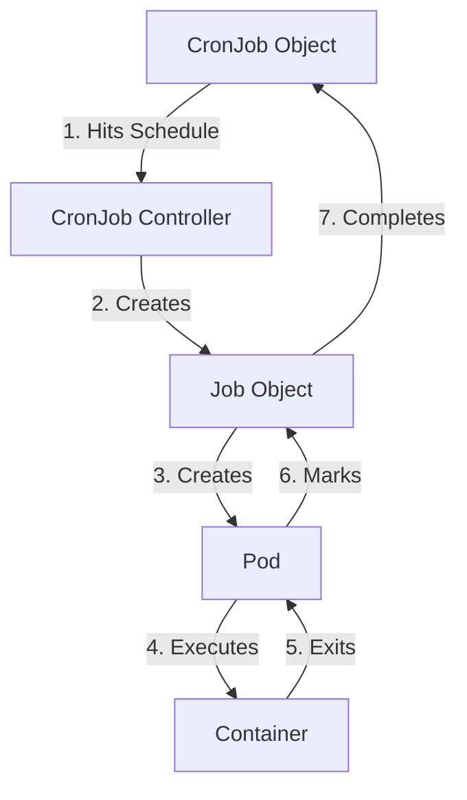

# What is a CronJob

## Introduction

A **CronJob** is a Kubernetes object that manages time-based Jobs. It allows you to run a specific task (a Job) on a schedule, such as every minute, every day at midnight, or every Monday at 9:00 AM. If you have ever used the standard Linux `cron` utility, you will find the Kubernetes CronJob very familiar, as it uses the exact same syntax for scheduling.

In the world of DevOps, CronJobs are essential for automating repetitive administrative tasks. While a regular Job runs once and completes, a CronJob ensures that the task is triggered automatically at the right time, every time. It acts as the "scheduler of schedulers" in your cluster.

---

## How the CronJob Controller Works

It is important to understand that a CronJob does not run your code directly. Instead, it is a controller that creates a **Job** object whenever the schedule matches the current time. The Job, in turn, creates the **Pod** that runs your container.



This three-tier architecture (CronJob → Job → Pod) is what allows Kubernetes to handle failures gracefully. If a Pod fails, the Job controller retries it. The CronJob controller simply keeps track of which Jobs it has created and whether they were successful.

---

## Cron Schedule Syntax In-Depth

The schedule is defined using a string of five fields separated by spaces. Each field represents a unit of time.

```text
# ┌───────────── minute (0 - 59)
# │ ┌───────────── hour (0 - 23)
# │ │ ┌───────────── day of the month (1 - 31)
# │ │ │ ┌───────────── month (1 - 12)
# │ │ │ │ ┌───────────── day of the week (0 - 6) (0 is Sunday)
# │ │ │ │ │
# │ │ │ │ │
# * * * * *
```

### Advanced Scheduling Symbols

To go deep, you must master the special characters used in cron strings:

1.  **The Asterisk (*)**: Means "every" or "any". `* * * * *` means every minute of every hour of every day.
2.  **The Comma (,)**: Used to list multiple values. `0 8,12,16 * * *` means run at 8 AM, 12 PM, and 4 PM.
3.  **The Hyphen (-)**: Defines a range. `0 9-17 * * 1-5` means every hour from 9 AM to 5 PM, but only on weekdays (Monday to Friday).
4.  **The Slash (/)**: Defines step values. `*/15 * * * *` means every 15 minutes. `0 0-12/3 * * *` means every 3 hours between midnight and noon.

### Common DevOps Schedule Examples

| Task | Schedule String | Explanation |
| :--- | :--- | :--- |
| **Database Backup** | `0 2 * * *` | Every day at 2:00 AM (off-peak hours). |
| **Cleanup Logs** | `30 23 * * 0` | Every Sunday at 11:30 PM. |
| **Status Update** | `*/10 * * * *` | Every 10 minutes, all day long. |
| **Monthly Billing** | `0 0 1 * *` | At midnight on the 1st of every month. |
| **Weekday Sync** | `0 8 * * 1-5` | Every Monday through Friday at 8:00 AM. |

---

## The CronJob YAML Structure

Let’s look at a production-grade CronJob that performs an AWS S3 data synchronization.

```yaml
apiVersion: batch/v1
kind: CronJob
metadata:
  name: s3-sync-job
  namespace: data-pipeline
  labels:
    app: s3-sync
    tier: infrastructure
spec:
  # Run every 30 minutes
  schedule: "*/30 * * * *"
  
  # Ensure we don't start a new sync if the previous one is still running
  concurrencyPolicy: Forbid
  
  # If the controller is down, how long can we wait before skipping this run?
  startingDeadlineSeconds: 100
  
  # How many successful/failed jobs to keep for debugging
  successfulJobsHistoryLimit: 3
  failedJobsHistoryLimit: 5
  
  # Target Time Zone (Supported in K8s 1.27+)
  timeZone: "UTC"

  jobTemplate:
    spec:
      # Max retries if the container crashes
      backoffLimit: 2
      # Kill the job if it doesn't finish in 15 minutes
      activeDeadlineSeconds: 900
      
      template:
        metadata:
          labels:
            app: s3-sync
        spec:
          # Required for Jobs/CronJobs
          restartPolicy: OnFailure
          
          # AWS IRSA Service Account for S3 Permissions
          serviceAccountName: s3-sync-sa
          
          containers:
          - name: sync-worker
            image: amazon/aws-cli:latest
            command:
            - /bin/sh
            - -c
            - |
              echo "Starting S3 Sync..."
              aws s3 sync /data/logs s3://my-prod-logs-bucket/$(date +%Y-%m-%d)
              echo "Sync completed successfully."
            
            resources:
              requests:
                cpu: "250m"
                memory: "256Mi"
              limits:
                cpu: "500m"
                memory: "512Mi"
            
            volumeMounts:
            - name: log-data
              mountPath: /data/logs
              readOnly: true
              
          volumes:
          - name: log-data
            persistentVolumeClaim:
              claimName: app-logs-pvc
```

---

## Deep Dive: Concurrency Policies

One of the biggest risks with CronJobs is "job overlap." If your task takes 2 minutes but you run it every 1 minute, you will soon have hundreds of Pods running, which can overwhelm your database or the cluster nodes.

### 1. `Allow` (The Default)
Kubernetes will start a new Job every time the clock hits the schedule, regardless of whether the previous Job is still running.
- **Scenario**: You have a lightweight script that just checks a health endpoint. Overlapping is fine.
- **Warning**: Never use this for data migrations or heavy processing.

### 2. `Forbid` (Recommended for DevOps)
The CronJob skips the new schedule if the previous Job is still running.
- **Scenario**: A database backup. You do not want two backup processes locking the same tables at the same time.
- **Behavior**: If a Job is skipped, it is recorded as a "missed" schedule.

### 3. `Replace`
If a new Job is scheduled while the old one is still running, Kubernetes kills the old Job and starts the new one.
- **Scenario**: You are generating a "Current Cluster Status" report. You only care about the latest data, so killing the old, stale report is fine.

---

## Managing Job History

By default, completed CronJobs will clutter your `kubectl get jobs` output. You must manage this using history limits.

- **`successfulJobsHistoryLimit`**: How many finished (successful) Jobs to keep. Usually set to 3.
- **`failedJobsHistoryLimit`**: How many failed Jobs to keep. Usually set higher (like 5) so you have more time to debug why a task failed before the objects are deleted.

```bash
# View the history for a specific CronJob
kubectl get jobs --selector=job-name=s3-sync-job -n data-pipeline

# If history limit is 3, you will only see the 3 most recent jobs
# NAME                COMPLETIONS   DURATION   AGE
# s3-sync-job-28401   1/1           45s        30m
# s3-sync-job-28402   1/1           40s        60m
# s3-sync-job-28403   1/1           42s        90m
```

---

## Important Flags and Timeouts

### `startingDeadlineSeconds`
Imagine your cluster's control plane goes down for 2 hours. Your CronJob is scheduled for every minute. When the control plane comes back up, does it try to run 120 Jobs at once to catch up?
- If `startingDeadlineSeconds` is NOT set, it might try to "burst" those jobs.
- If set (e.g., to 60), Kubernetes will only look back 60 seconds. If it missed the window, it simply skips the old runs. **Always set this to avoid thundering herd problems.**

### `suspend`
Sometimes you need to pause a CronJob (e.g., during a maintenance window). Instead of deleting the object, you can suspend it.

```bash
# Pause the schedule
kubectl patch cronjob s3-sync-job -p '{"spec" : {"suspend" : true }}'

# Resume the schedule
kubectl patch cronjob s3-sync-job -p '{"spec" : {"suspend" : false }}'
```

---

## Summary

- **CronJobs** are the automated schedulers of Kubernetes, using the standard 5-field cron syntax for timing.
- They follow a hierarchy: **CronJob** creates a **Job**, which creates a **Pod**.
- **Concurrency Policies** are critical: Use `Forbid` for data tasks and `Replace` for status tasks to prevent resource exhaustion.
- **`startingDeadlineSeconds`** is your insurance policy against cluster downtime causing a massive burst of jobs.
- **History Limits** keep your cluster clean while ensuring you have enough data to debug recent failures.
- **AWS Integration**: Use ServiceAccounts with IRSA to give CronJobs secure access to AWS resources like S3 or RDS.

In the next file, `04-cronjob-best-practices.md`, you will learn how to design these tasks for production, focusing on idempotency, monitoring, and security.
